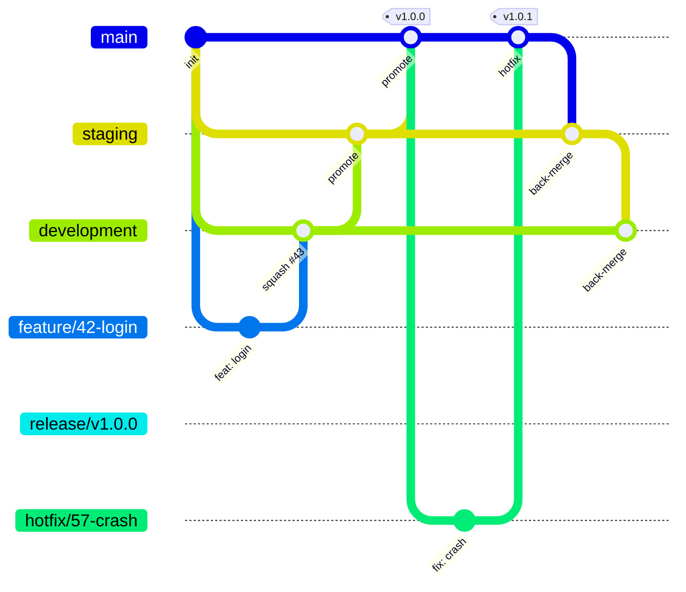

# Branching strategy

Feature branches flowing through three long-lived environment branches, with release backups.



## Branches

| Branch | Role | Who writes | Protection (ruleset) |
|---|---|---|---|
| `main` | **Production**. GitHub default branch. Every commit is releasable | PRs from `staging` or `hotfix/*` only | no delete / force-push, PR + **1 approval**, checks `branch-flow` `pr-title` `ci`, merge-commit only |
| `staging` | **Pre-production / UAT**. What is about to ship | PRs from `development`, `hotfix/*`, back-merge from `main` | same as `main` |
| `development` | **Integration**. Daily target for work branches | PRs from work branches, back-merges | no delete / force-push, PR (0 approvals), same checks, squash or merge |
| `release/vX.Y.Z` | **Read-only backup** of each release, created by the Release workflow | nobody (workflow creates it) | no delete, no force-push, **no updates** |
| `feature/*`, `fix/*`, `chore/*`, `docs/*`, `refactor/*`, `test/*`, `ci/*`, `perf/*`, `build/*`, `style/*` | Short-lived work | the author | none — deleted automatically after merge |
| `hotfix/*` | Urgent production fix, branched from `main` | the author | none |

Tags `v*` are protected by the `version-tags` ruleset (no delete / move).

## Allowed PR directions (enforced by the `branch-flow` check)

| Into ↓ / from → | work branches | `development` | `staging` | `main` | `hotfix/*` |
|---|---|---|---|---|---|
| `development` | ✅ squash | — | ✅ back-merge | ✅ back-merge | ❌ |
| `staging` | ❌ | ✅ promote | — | ✅ back-merge | ✅ |
| `main` | ❌ | ❌ | ✅ promote | — | ✅ |
| `release/*` | ❌ | ❌ | ❌ | ❌ | ❌ |

`revert-*` branches (GitHub's **Revert** button) are allowed into any of the three.
Any PR into a non-protected branch (stacked PRs) is allowed.

## Merge methods — why two

- **Work branch → `development`: squash.** One clean commit per PR; the PR title (Conventional Commit) becomes the message.
- **Promotions and back-merges: merge commit.** Squashing `development` into `staging` would create new commits that `development` does not have, so the branches drift apart and every later promotion conflicts. Merge commits keep the history shared.

The rulesets enforce this (`allowed_merge_methods`).

## Day-to-day

```bash
git switch development && git pull
git switch -c feature/42-sso-login
# ...commit...
git push -u origin feature/42-sso-login
gh pr create --base development --title "feat(auth): add SSO login" --body "Refs #42"
```

## Promotion

```bash
gh pr create --base staging --head development --title "promote: development to staging"
# after UAT sign-off
gh pr create --base main --head staging --title "promote: staging to main"
```

Then run the **Release** workflow on `main` (see [release process](release-process.md)).

## Hotfix

1. `git switch main && git pull && git switch -c hotfix/57-crash`
2. PR into `main` (title `fix: ...` or `hotfix: ...`), approve, merge.
3. Release a patch version.
4. **Sync down** workflow opens back-merge PRs `main → staging` and then `staging → development`.
   PRs opened by a workflow don't trigger checks automatically: **close and reopen** them to run checks, then merge (merge commit).

## Emergency bypass

Org admins and repo admins can bypass approval **on a PR** (option "Merge without waiting for requirements"). Direct pushes are still blocked. Write the reason in the PR when you do it.
